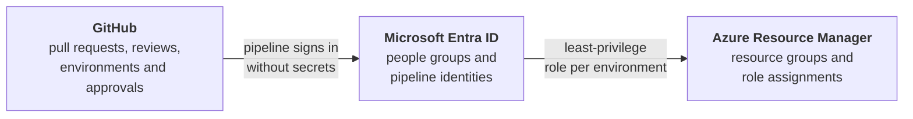

<!-- omit from toc -->
# Azure Platform Kite

[](https://github.com/msckite/az-platform-kite/releases)
[](https://www.powershellgallery.com/packages/MSCKite.Azure.Platform)
[](https://github.com/msckite/az-platform-kite/issues)

</br>

<!-- markdownlint-disable-next-line MD033 -->
<p></p>

By **MSCKite™**  
_Lighter Work. Higher Impact._

</br>

> [!IMPORTANT]
> This module is intended primarily for personal use and is currently under active development.

<!-- omit from toc -->
## Table of Contents

- [What's this repo about?](#whats-this-repo-about)
- [How it works](#how-it-works)
- [Who can do what](#who-can-do-what)
- [What do you get?](#what-do-you-get)
- [Why use Kite?](#why-use-kite)
- [How to use it?](#how-to-use-it)
- [Upgrading](#upgrading)
- [License](#license)

## What's this repo about?

**Azure Platform Kite** helps a team set up a safe, repeatable way to build software on Azure:
separate environments for development, testing and production, and a governed path that carries every
change from a developer's pull request all the way to Azure.

Setting this up by hand is slow and easy to get wrong. People end up with shared credentials, environments
that drift apart, and nobody quite sure who is allowed to change what. Kite replaces that with one
configuration file that describes your environments and who may do what in them. A set of PowerShell
commands then creates everything from that file, and you can safely run them again whenever the file changes.

The result is a foundation where:

- every environment (`dev`, `stg`, `prd`) is created the same way, every time;
- people and pipelines only get the access they need, in the environment where they need it;
- changes reach production through reviewed pull requests and approvals, not through someone's laptop.

## How it works

Kite connects three places, and keeps the permissions consistent across all of them:



You describe your platform once, across the three files in `config/platform/` (`resource-groups.jsonc`, `security-groups.jsonc` and `environments.jsonc`). Kite then sets it up in four ordered steps:

| Step | What Kite creates | Why it matters |
| ---- | ----------------- | -------------- |
| 1. Resource groups | One Azure resource group per environment | Each environment is isolated and tagged for ownership and cost |
| 2. Security groups | Groups for developers, administrators and stakeholders, with their Azure roles | People get access through group membership, not one-off grants |
| 3. Pipeline identities | One identity per environment that GitHub can use to sign in to Azure | No passwords or keys stored in GitHub; access exists only while a pipeline runs |
| 4. GitHub environments | `dev`, `stg` and `prd` environments with the values pipelines need | Approvals and branch rules can be enforced before a deployment starts (off by default; see the config) |

From there, ready-made GitHub Actions workflows move changes through the stages. You choose a branching
model: a simple one that promotes through `dev` to `prd`, or a release-based one that adds a `stg` stage
for verification before production.

## Who can do what

Access is enforced at every link of the chain, from the person writing code to the Azure resource being changed.

| Who or what | `dev` | `stg` | `prd` |
| ----------- | :---: | :---: | :---: |
| Developers | Contributor | Contributor | Reader |
| Administrators | Owner | Owner | Owner |
| Stakeholders | Reader | Reader | Reader |
| Application pipeline | Deploy code | Deploy code | Deploy code |
| Infrastructure pipeline | Deploy infrastructure | Deploy infrastructure | Deploy infrastructure |

These roles are the defaults in the starter configuration. You can change them in `config/platform/security-groups.jsonc`.

What this gives you:

- **Developers can build, but cannot change production directly.** They have read-only access to `prd` and
  reach it only through the pipeline.
- **Code and infrastructure are deployed by different identities.** The application pipeline can deploy code but
  cannot change infrastructure; only the infrastructure pipeline can. Application changes cannot quietly alter
  your cloud setup.
- **Each environment has its own identity.** An identity for `dev` cannot touch `prd`, and a pipeline run is
  tied to a specific GitHub environment, so GitHub protection rules (such as required approvals, which you can switch on per environment) apply before it can sign in to Azure.
- **The platform itself is governed too.** Changes to the platform configuration are previewed in a pull request
  (read-only) and applied only from `main`, by a separate, more privileged identity.
- **No stored secrets for Azure access.** Pipelines sign in with short-lived tokens (OIDC federation) instead of passwords.

## What do you get?

Kite ships as a PowerShell module and a set of starter templates:

- **The module** (`MSCKite.Azure.Platform`): commands that create the resource groups, Entra security groups, pipeline identities and GitHub environments described above, plus commands to inspect your current platform context.
- **Configuration templates**: a starting point for the one file that describes your environments and who may do what.
- **Workflow templates**: GitHub Actions pipelines for the platform itself, application code and infrastructure, staged across your environments.

<!-- omit from toc -->
### Key Capabilities

- Provision Azure and Microsoft Entra resources from configuration files
- Configure GitHub environments, secrets and variables to match
- Run the same provisioning from a pipeline, with changes previewed in pull requests
- Support Internal Developer Platform (IDP) and self-service initiatives

> [!NOTE]
> Although this toolkit is designed with Azure DevOps integration in mind, the first release focuses on Azure with GitHub integration. Azure DevOps commands are planned for a later major release. Until then, you can still use the easy `Get-*` and `Disconnect-PlatformContext` commands to inspect and clear your platform context.

## Why use Kite?

> _Just as a kite harnesses the power of the wind to move efficiently with minimal effort, Azure Platform Kite helps engineers harness the power of the cloud through automation, standardization, and reusable building blocks._

<!-- omit from toc -->
### Built with AI, Designed for Automation

Azure Platform Kite is built and maintained with AI assistance, but designed to reduce dependency on AI for routine operational tasks. Knowledge and workflows are captured in reusable automation so that common platform activities can be executed consistently, reliably, and without repeatedly spending time or tokens on the same questions.

<!-- ## The Kite Philosophy

AI is an excellent co-pilot, but repetitive operational work should not require a conversation every time.

Azure Platform Kite transforms knowledge, experience, and AI-assisted engineering into reusable automation that can be executed on demand. The goal is simple: use AI to create better tools, then use those tools to work faster, more consistently, and with less friction. -->

## How to use it?

> [!TIP]
> Explore all available cmdlets in the [help documentation](docs/MSCKite.Azure.Platform/MSCKite.Azure.Platform.md), including detailed usage, parameters, and examples.

### Quickstart

<!-- omit from toc -->
#### 1. Install from the PowerShell Gallery

```powershell
Install-Module -Name 'MSCKite.Azure.Platform' -Scope CurrentUser
```

<!-- omit from toc -->
#### 2. Log in to each platform you'll be working with

```powershell
Connect-AzAccount       # Azure
Connect-AdoOrganization # Azure DevOps
gh auth login           # GitHub
```

<!-- omit from toc -->
#### 3. Verify you're connected to the right platforms

```powershell
Get-PlatformContext
```

`Get-PlatformContext` combines your _Azure_, _Azure DevOps_, and _GitHub_ connectivity state into a single object, so you can confirm everything lines up before running deployments across platforms.

<!-- omit from toc -->
#### Sample json output

```json
{
  "Azure": {
    "Account": "user@contoso.com",
    "Tenant": "00000000-0000-0000-0000-000000000000",
    "SubscriptionId": "00000000-0000-0000-0000-000000000000",
    "SubscriptionName": "sub-contoso-workloads",
    "Environment": "AzureCloud",
    "IsSignedIn": true
  },
  "GitHub": {
    "Account": "github-user",
    "Host": "github.com",
    "Protocol": "https",
    "TokenScopes": "'gist', 'read:org', 'repo', 'workflow'",
    "IsSignedIn": true
  }
}
```

<!-- omit from toc -->
#### 4. (Optional) Set the default GitHub _Owner_ and _Repository_

If you're about to run several GitHub commands, set a default owner/repository so you don't have to pass them on every call.

```powershell
Set-GitHubDefault -Owner 'msckite' -Repository 'az-platform-kite'
```

Use `Get-GitHubDefault` at any time to see what's currently stored:

```powershell
Get-GitHubDefault
```

```text
Owner   Repository       RepositoryUri
-----   ----------       -------------
msckite az-platform-kite https://github.com/msckite/az-platform-kite
```

Reset the defaults by passing `$null`:

```powershell
Set-GitHubDefault $null
```

> [!TIP]
> The same pattern applies to Azure DevOps, using `Set-AdoDefault` and `Get-AdoDefault` to manage your default organization/project instead.

### Staged platform setup

Working from your local repository, download the templates, scaffold the configuration folder from them, and fill in `global-config.jsonc` and the files in `config/platform/`:

```powershell
Get-PlatformTemplate -IncludedFolders 'templates' -OutputFolder ./.tmp
New-PlatformConfigStructure -InputFolder ./.tmp/templates -OutputFolder ./config
Copy-Item ./.tmp/templates/platform ./config -Recurse
```

`Get-PlatformTemplate` downloads `global-config.jsonc` and the other templates of the Kite release you are running (its release tag, not `main`) into `.tmp`. `New-PlatformConfigStructure` seeds your repository's `config` folder with the downloaded `global-config.jsonc`, so nothing you edit later is ever overwritten by a new download. It also sets `kiteVersion` to the module version you are running, which pins your pipelines to this Kite release until you change it in a pull request (see [Pinning the Kite version](templates/github/workflows/README.md#pinning-the-kite-version)).

<br/>

> [!IMPORTANT]
> Leave the `${placeholder}` tokens in the `config/platform/` files intact: they are resolved at runtime against `global-config.jsonc` and the environment being provisioned, which is what keeps names, tags and secrets consistent across every phase. Replacing them with literal values breaks that single source of truth.

<br/>

Then run the four provisioning phases in order:

```powershell
Set-PlatformResourceGroup       # Phase 1: Azure resource groups
Set-PlatformSecurityGroup       # Phase 2: Entra security groups and their RBAC roles
Set-PlatformEnvironmentIdentity # Phase 3: Federated user-assigned identities and their RBAC roles
Set-PlatformGitHubEnvironment   # Phase 4: GitHub environments, secrets and variables
```

Every phase is idempotent, so you can safely rerun the whole sequence after changing the configuration. Add `-WhatIf` to preview the changes first, or `-Verbose` to see detailed progress.

Once the first run has completed, hand the recurring runs over to GitHub Actions:

```powershell
New-PlatformWorkflow
```

`New-PlatformWorkflow` reads the workflow manifest from `.tmp/templates` and copies the [workflow templates](templates/github/workflows/README.md) for your `sourceControl.branchStrategy` into `.github` of your repository. That ships a CI/CD pipeline staged across `dev`/`prd` (`github`) or `dev`/`stg`/`prd` (`release`), running the same four phases in dependency order. Existing files are left untouched unless you pass `-Force`.

> [!NOTE]
> The platform workflows are optional. Many teams run the four phases locally once and change the platform only now and then. Install the platform bundle (`New-PlatformWorkflow -WorkflowType platform`) if you want later platform changes reviewed in pull requests and reconciled by GitHub Actions, or leave it out and keep running the phases locally. See [Choosing how to run the platform phases](templates/github/workflows/README.md#choosing-how-to-run-the-platform-phases).

> [!IMPORTANT]
> Before the pipeline can run phase 4, add `PLATFORM_GITHUB_TOKEN` by hand as an **environment secret** on the `platform` GitHub environment; the built-in `GITHUB_TOKEN` cannot manage environment secrets. See the [prerequisites](templates/github/workflows/README.md#prerequisites) section of the workflow templates README for the full setup steps.

> [!NOTE]
> The platform pipeline signs in as dedicated environments declared in `config/platform/environments.jsonc`, not one of your app environments. `platform-cd.yml` uses `platform`, whose identity holds subscription-level RBAC (`Contributor` and `User Access Administrator`, both scoped to `subscription`) and which only accepts runs from `main`. `platform-ci.yml` previews pull requests as `platform-plan`, a read-only twin with subscription-level `Reader`. See the [prerequisites](templates/github/workflows/README.md#prerequisites) for the one-time setup of both.

## Upgrading

Moving to a newer release can require changes in your configuration. See [Upgrading](docs/upgrading.md).

## License

Copyright (c) 2026 Martin Swinkels

All Rights Reserved

<!-- omit from toc -->
## Disclaimer

This repository is provided "**as is**" and is subject to **limited support**. While reasonable efforts
have been made to ensure its usefulness, there are **no warranties or guarantees** regarding accuracy,
reliability, security, or ongoing maintenance. By using this code, you acknowledge and agree that you
do so at your own risk. It is your responsibility to validate, test, and ensure suitability for your specific
use case, particularly in production environments. We welcome community contributions and feedback to improve
the project; however, official support will limited.

<!-- omit from toc -->
## Liability

Under no circumstances shall the authors, contributors, or affiliated organizations be held liable for
any direct, indirect, incidental, or consequential damages arising from the use of this repository, including
but not limited to loss of data, business interruption, or system failures.
Use of this code implies acceptance of these terms.

<!-- omit from toc -->
## Trademarks

This project may contain trademarks or logos for projects, products, or services. Authorized use of Microsoft
trademarks or logos is subject to and must follow
[Microsoft's Trademark & Brand Guidelines](https://www.microsoft.com/legal/intellectualproperty/trademarks/usage/general).
Use of Microsoft trademarks or logos in modified versions of this project must not cause confusion or imply Microsoft
sponsorship. Any use of third-party trademarks or logos are subject to those third-party's policies.

</br>

<!-- markdownlint-disable-next-line MD033 -->
<p></p>

**MSCKite™**  
_Lighter Work. Higher Impact._
