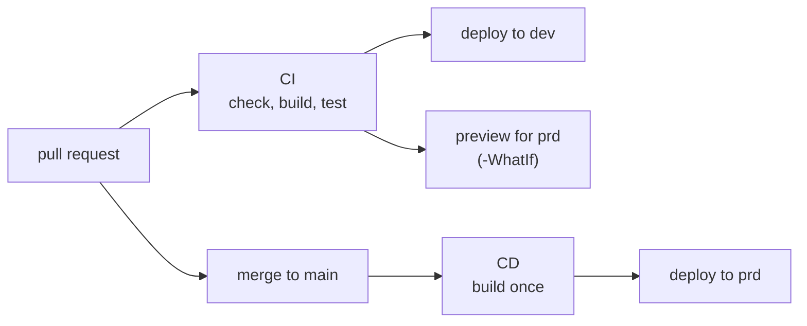

<!-- omit from toc -->
# GitHub Flow

GitHub Flow is the short path to production: you open a pull request, it is checked and tried in
`dev`, and when you merge it to `main` the change is deployed to `prd`. Choose it with
`"branchStrategy": "github"` in `config/global-config.jsonc`. See the
[workflows overview](./README.md) for how to choose between the strategies.

<!-- omit from toc -->
## Table of Contents

- [What happens when](#what-happens-when)
- [Workload and infra](#workload-and-infra)
- [One build, deployed everywhere](#one-build-deployed-everywhere)

## What happens when

| Event | What runs |
| --- | --- |
| A pull request to `main` | CI checks, builds and tests the change, deploys it to `dev` and shows what would change in `prd` without changing anything. |
| A push to `main` | CD builds the change once and deploys that build to `prd`. |

## Workload and infra

Workload and infra work the same way, but each reacts only to its own folder, so they never trigger
each other.

| | Workload | Infra |
| --- | --- | --- |
| Reacts to changes in | `src/` and `.github/workflows/workload-*.yml` | `iac/` and `.github/workflows/infra-*.yml` |
| Signs in with | The `dev-workload`, `prd-workload` environments | The `dev-infra`, `prd-infra` environments |
| CI checks | Builds and tests the code | Checks and builds the Bicep files |

Changes to the platform files never run either of them.

## One build, deployed everywhere

The workload builds each change once and deploys that exact, tested package to every environment,
instead of building again for each one. The package is kept as a run artifact named
`workload-package`.

- Put your build output in the folder named by the `PACKAGE_PATH` environment variable. The sample
  writes a small placeholder file there (commit, branch, run id and build time), so the flow works
  before you have a real build.
- The deploy step never builds. It downloads the package and deploys it.

Run artifacts are kept for your repository's retention period (**Settings > Actions > General >
Artifact and log retention**, 90 days by default).
