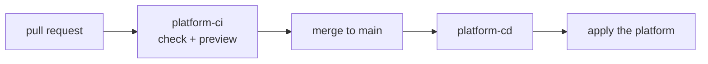

<!-- omit from toc -->
# Platform flow

The platform flow keeps your platform in line with the files in `config/platform/`. It runs the four
platform phases for you from GitHub Actions. This is optional: you can also run the phases from your
own computer, and many teams do.

<!-- omit from toc -->
## Table of Contents

- [Should you use it?](#should-you-use-it)
- [How it works](#how-it-works)
- [Two identities, on purpose](#two-identities-on-purpose)
- [One-time setup](#one-time-setup)

## Should you use it?

| Option | When it fits | Install with |
| --- | --- | --- |
| Run from your computer | The platform rarely changes, or one person or team looks after it. | Skip the platform bundle: `-WorkflowType workload`, `infra` or both of those. |
| Run through GitHub Actions | You want platform changes reviewed in pull requests and applied by a pipeline. | `-WorkflowType both` (the default), `all` or `platform`. |

Either way the phases work on the one repository named by `sourceControl.owner` and
`sourceControl.repository` in `global-config.jsonc`. The platform workflows therefore run in that
repository. A separate repository for them is not supported.

## How it works



- A **pull request** that changes the platform files runs `platform-ci`. It checks your files and
  shows what would change, without changing anything. Make it a required check on `main`.
- A **merge to `main`** runs `platform-cd`, which applies the whole configuration.

The four phases run in a fixed order. The resource groups come first. The security groups and the
identities both need them and run side by side. The GitHub environments come last, because they
need the identity's client id.

## Two identities, on purpose

The two workflows do not sign in with the same identity:

| Workflow | GitHub environment | Access | Who can use it |
| --- | --- | --- | --- |
| `platform-cd` | `platform` | `Contributor` and `User Access Administrator` on the subscription | Runs from `main` only |
| `platform-ci` | `platform-plan` | `Reader` on the subscription | Any branch, including pull requests |

A preview only reads, so it never needs write access. This keeps the powerful identity out of reach
of pull requests: someone can edit a workflow in a pull request and ask for the `platform-plan`
environment, but GitHub will not give the `platform` environment's token or secrets to a run outside
`main`.

## One-time setup

Do these once, after you ran the four phases from your computer for the first time.

1. **Allow the platform identity to read Entra groups.** The security group phase reads groups, so
   the `platform` identity needs the Microsoft Graph permission `Group.Read.All`. Add
   `Group.ReadWrite.All` only if the pipeline should also create and change groups. Use the
   `PrincipalId` from the output of the identity phase:

   ```powershell
   Grant-PlatformGraphPermission `
    -PrincipalId '<principalId-of-the-platform-environment>' `
    -Permission 'Group.Read.All'
   ```

   This is a manual step on purpose. Granting Graph permissions takes a directory role such as
   Application Administrator, and a pipeline identity should never hold that role. Without the
   grant, the security group phase fails or reports existing groups as missing.

   Give the `platform-plan` identity (`Platform (plan)` in the same output) `Group.Read.All` too,
   and nothing more.

2. **Add `PLATFORM_GITHUB_TOKEN` to the `platform` environment.** In GitHub, open **Settings >
   Environments > platform > Secrets** and add an environment secret, not a repository secret. Use
   a fine-grained personal access token or a GitHub App token with write access to administration,
   environments, secrets and variables on this repository. The built-in `GITHUB_TOKEN` cannot manage
   environment secrets, so the last phase fails without it.

   Keep this secret out of `environments.jsonc`. Every secret listed there is written again on each
   run and would overwrite your token with the placeholder text. Change its value only in GitHub
   (the UI or `gh secret set`).

3. **Add a read-only token to `platform-plan`.** Add a secret with the same name,
   `PLATFORM_GITHUB_TOKEN`, to the `platform-plan` environment. Make it a fine-grained token limited
   to this repository with read-only access to actions, administration, environments, secrets and
   variables. A preview only lists these things, and a pull request can never use this token to
   change them.

4. **Create the environments before the first pull request.** The `platform` environment only
   accepts runs from `main`, so the very first pull request that introduces `platform-plan` cannot
   create it through `platform-ci`. Create both from your computer (the identity phase and the GitHub
   environment phase), complete steps 1 to 3 for them, and only then open that pull request.
