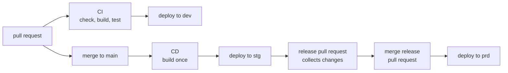

<!-- omit from toc -->
# Release Flow

Release Flow puts a safety step between a merge and production. Every merge to `main` is deployed
to `stg` first. A change only reaches `prd` when you decide so, by merging a release pull request,
and only if `stg` already ran exactly that content. Choose it with `"branchStrategy": "release"` in
`config/global-config.jsonc`. See the [workflows overview](./README.md) for how to choose between the
strategies.

<!-- omit from toc -->
## Table of Contents

- [What happens when](#what-happens-when)
- [Workload and infra](#workload-and-infra)
- [How a release works](#how-a-release-works)
- [What `stg` has to prove](#what-stg-has-to-prove)
- [Same package in `stg` and `prd`](#same-package-in-stg-and-prd)
- [Set up releases](#set-up-releases)
- [Adapting the release sample](#adapting-the-release-sample)

## What happens when

| Event | What runs |
| --- | --- |
| A pull request to `main` | CI checks, builds and tests the change, deploys it to `dev` and shows what would change in `stg` without changing anything. |
| A push to `main` | CD builds the change once, deploys it to `stg`, and shows what would change in `prd`. |
| A release is published | The release workflow deploys to `prd`, if `stg` ran this content successfully. |

## Workload and infra

Workload and infra each have their own CI, CD and release workflow, and their own release pull
request. One can go to production without the other.

| | Workload | Infra |
| --- | --- | --- |
| Reacts to changes in | `src/` and `.github/workflows/workload-*.yml` | `iac/` and `.github/workflows/infra-*.yml` |
| Signs in with | The `-workload` environments | The `-infra` environments |
| Release tags look like | `workload/v1.2.0` | `infra/v1.2.0` |

Each release workflow only acts on tags that start with its own prefix, so publishing an
`infra/...` release never deploys the workload, and the other way around.

## How a release works

Release Flow comes with a [release-please](https://github.com/googleapis/release-please) sample
that versions and releases infra and workload independently.

1. **Merge pull requests as usual**, with
   [Conventional Commits](https://www.conventionalcommits.org/) titles: `fix: ...` for a patch,
   `feat: ...` for a minor version, `feat!: ...` (or a `BREAKING CHANGE:` footer) for a major one.
   With squash merges, the pull request title becomes the commit message. release-please decides
   whether a change belongs to infra or workload by the folder it changed, not by its title.
2. **Test in `stg`.** Every merge is deployed to `stg`. release-please keeps one open release pull
   request per deliverable, for example `chore(main): release infra 1.3.0`, with the next version
   and its `CHANGELOG.md` entries. It keeps collecting changes while you test.
3. **Merge the release pull request to go to production.** That is your decision to release.
   release-please creates the tag and the GitHub release and starts the release workflow, which
   checks `stg` and deploys `prd`.

A release pull request only changes `CHANGELOG.md`, `version.txt` and the version file, so it does
not trigger another `stg` deployment and does not count as new content. The release goes ahead with
the content `stg` already ran.

You can also publish a release by hand in GitHub. The release workflow then runs as well, with the
same checks.

> [!NOTE]
> A release created with the built-in `GITHUB_TOKEN` does not trigger other workflows, so
> `release-please.yml` starts the production deployment itself. Do not give release-please a
> personal access token or a GitHub App token without removing that step, or both paths deploy.

## What `stg` has to prove

Production only gets content that `stg` ran successfully. After each successful `stg` deployment,
the CD workflow records the result on the commit as a check named `kite/stg-workload` or
`kite/stg-infra`. Before deploying `prd`, the release workflow looks on `main` for a commit with
identical content and a successful check. Without one, nothing is deployed to `prd`.

The check compares **content**, not the position of a commit in history:

- A release cut from a later commit that did not change the deliverable still passes. That includes a
  workload-only change when releasing infra, and a release commit that only updates `CHANGELOG.md`
  or `version.txt`.
- Content whose `stg` deployment failed never passes, even if a later commit deployed
  successfully.

Changes outside the deliverable folder, such as workflow files, are not part of the check. If your
deliverables live in other folders than `iac/` and `src/`, adapt the folder and the ignored files
in `.github/scripts/stg-verification.sh`.

## Same package in `stg` and `prd`

The workload is built once, when the change is merged, and that package is deployed to `stg`. The
production deployment builds nothing. It reuses the package from the `stg` run, so `prd` runs exactly
what you tested. The package therefore shows the commit that `stg` deployed, which can be older than
the release commit when only the changelog changed since.

Run artifacts are kept for your repository's retention period (**Settings > Actions > General >
Artifact and log retention**, 90 days by default). If the `stg` package has expired, the release
fails to download it and does not reach `prd`. To recover, run the workload CD again from `main` to
deploy a fresh package to `stg`, then start the release workflow again with the same tag. The same
applies to the first workload release after you adopt this setup: a CD run with the build step has to
have deployed to `stg` first.

For a container image, push it to a registry in the build step instead, tag it with the commit and
deploy it by digest. The same promotion rules apply.

## Set up releases

Do this once per repository:

1. **Allow release-please to open pull requests.** Open **Settings > Actions > General > Workflow
   permissions** and enable **Allow GitHub Actions to create and approve pull requests**.
2. **Set the current version of each deliverable** in `.github/release-please/manifest.json`, so
   release-please continues from your latest release. Use `"iac": "1.2.0"` when `infra/v1.2.0`
   exists. For a deliverable without releases, keep `0.0.0`. To choose the first version yourself,
   add a `Release-As: 1.0.0` footer to a commit message.
3. **Remove what you do not use.** Delete the package of a deliverable you do not have from
   `.github/release-please/config.json`. Change its `release-type` (for example to `node`) if
   release-please should also bump your project's own version file.

| File | What it does |
| --- | --- |
| `.github/release-please/config.json` | Declares the deliverables: `iac/` as component `infra` and `src/` as component `workload`, one release pull request each, with tags like `infra/v1.3.0`. |
| `.github/release-please/manifest.json` | The current version of each deliverable. release-please updates it with every release. |
| `.github/workflows/release-please.yml` | Runs on every push to `main`. |

The configuration is kept in `.github/release-please/` instead of release-please's default location
in the repository root, so `release-please.yml` passes both paths explicitly. The package paths
inside `config.json` (`iac`, `src`) stay relative to the repository root.

## Adapting the release sample

Most names can be changed freely, but some are used in more than one place and must be changed
together:

| When you change | Also update |
| --- | --- |
| The location or name of `config.json` or `manifest.json` | `config-file` and `manifest-file` in `release-please.yml`. |
| A deliverable folder, for example `iac` to `infra` | Its package key in `config.json` and in `manifest.json` (both must match the folder path), the `iac--release_created` and `iac--tag_name` outputs in `release-please.yml`, the folder argument of the `stg-verification.sh` calls in the CD and release workflows, and the `iac/**` path filters of CI and CD. |
| A component name (the tag prefix), for example `infra` | The `startsWith(..., 'infra/')` conditions in the matching release workflow. |
| A release workflow file name, for example `infra-release.yml` | The `gh workflow run` line in `release-please.yml`. |
| The changelog or version file (`changelog-path`, `version-file`, or another `release-type`) | The `!` exclusions in the CI and CD path filters, and the ignored files in `stg-verification.sh`, so release commits still skip `stg` and pass the check. |

The file name `release-please.yml` itself is free: nothing refers to it.
